# Báo cáo TASK M6 — Khung game hoàn chỉnh

Một commit (`Task: M6`). Chi tiết kỹ thuật ở [architecture.md](../architecture.md) mục 2q. Ảnh chụp nằm trong [M6/](M6/). Ảnh được chụp từ game thật có cửa sổ: bot `tools/playtest/farming_playtest.gd` gửi input thật, nhật ký chạy ở [M6/playtest_log.txt](M6/playtest_log.txt).

## Ảnh chụp

| Màn | Ảnh |
|---|---|
| Màn hình tiêu đề (chưa có save nên không có Tiếp tục; bản debug có 2 nút [Debug]) | 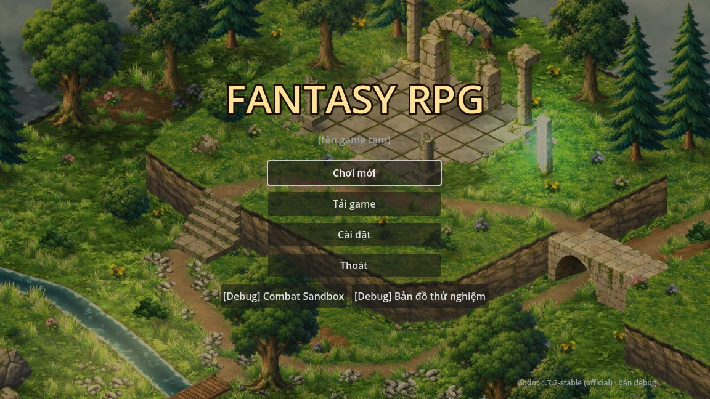 |
| Chơi mới → chọn ô | 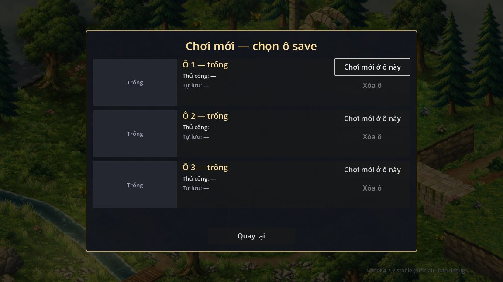 |
| Bảng gợi ý phím lần đầu chơi mới | 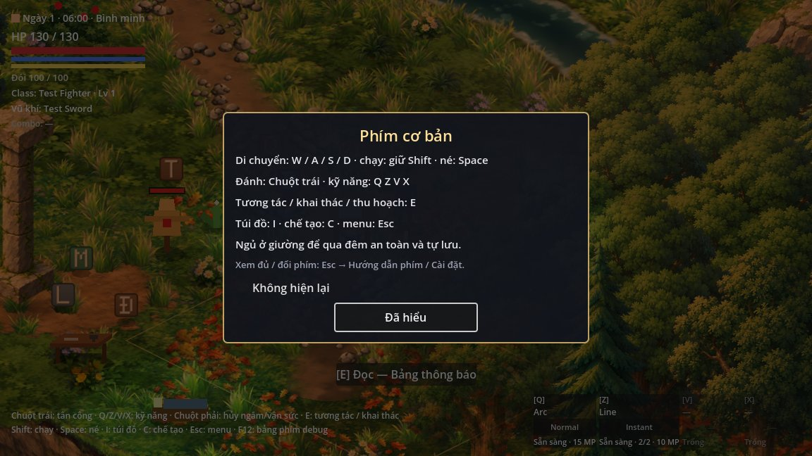 |
| Menu tạm dừng (Esc) | 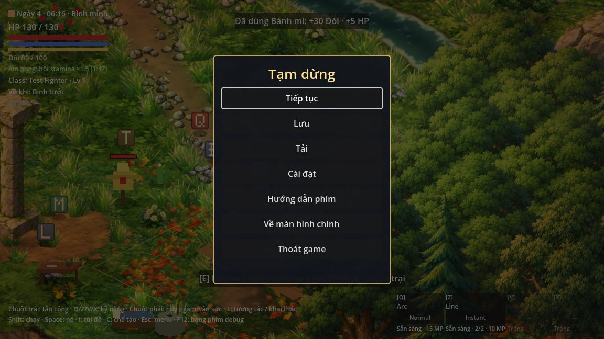 |
| Lưu → chọn ô | 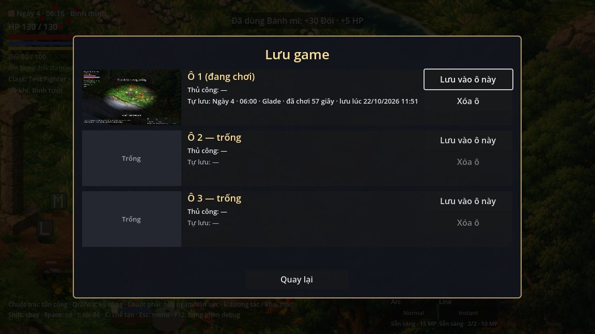 |
| Màn tải game (mỗi ô có bản thủ công + bản tự lưu, ảnh nhỏ, ngày / giờ game, thời gian chơi, giờ lưu, map) | 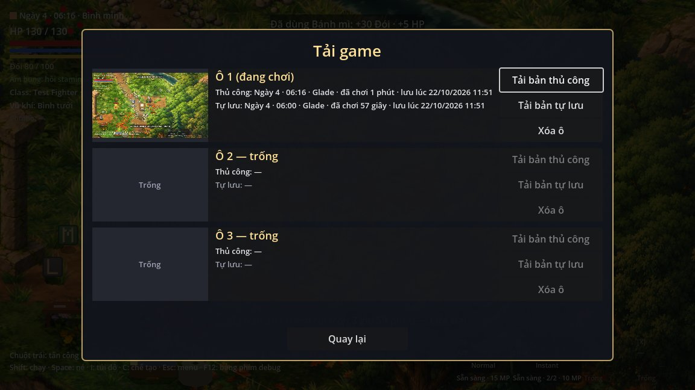 |
| Hướng dẫn phím | 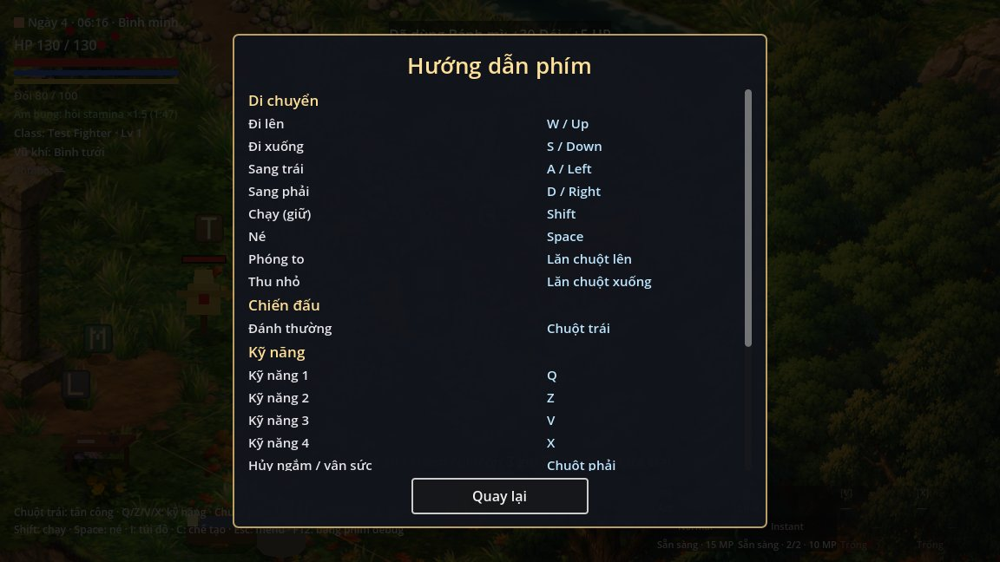 |
| Cài đặt → Âm thanh / Hình ảnh / Điều khiển | 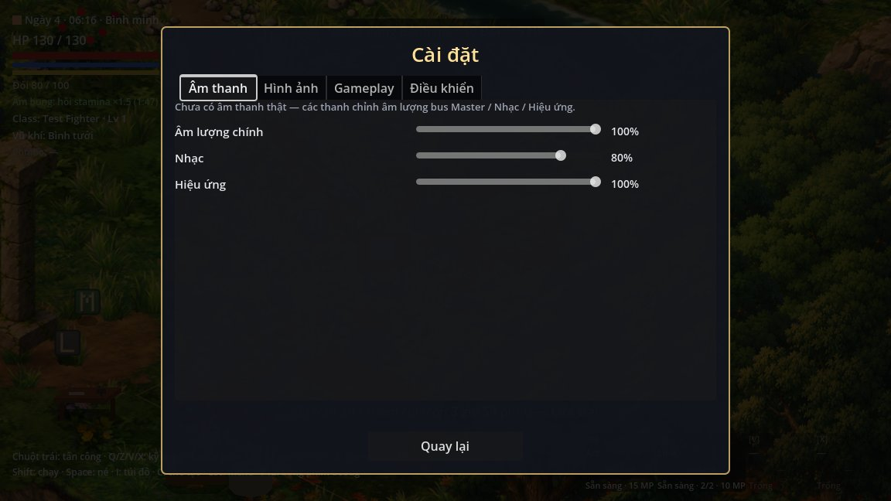 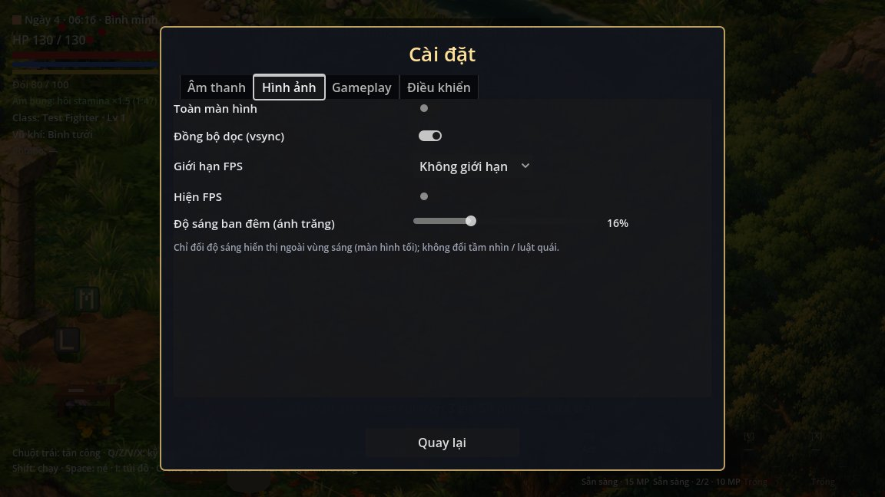 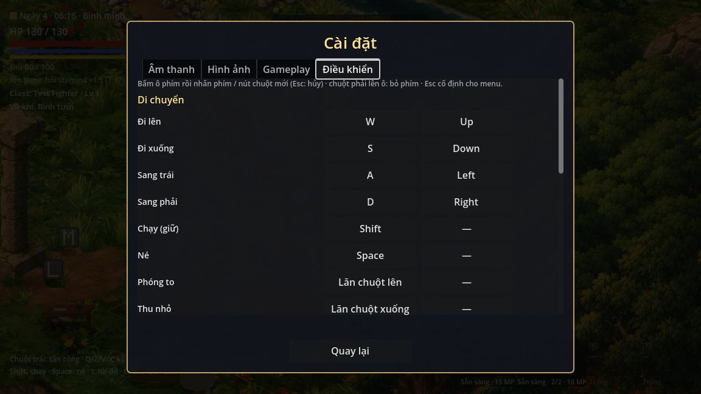 |
| Ruộng mới 6 × 4 ô lưới thật: ngày đầu / lúa chín sáng ngày 4 / ban đêm | 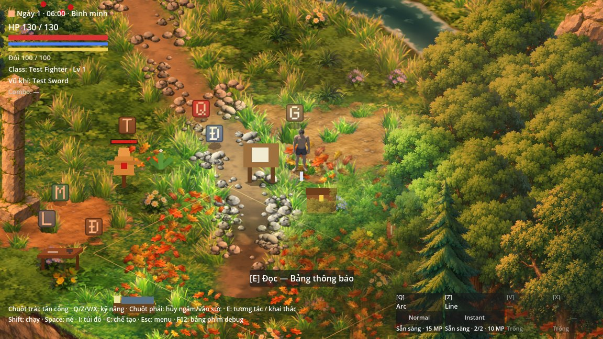 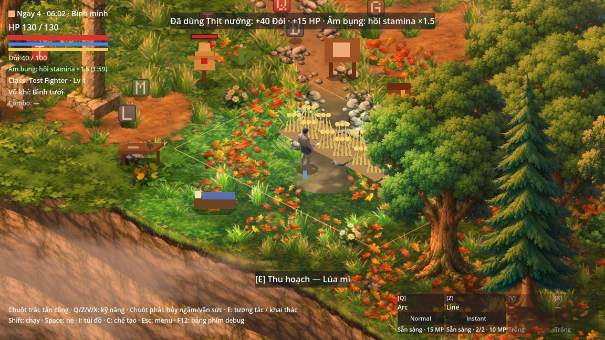 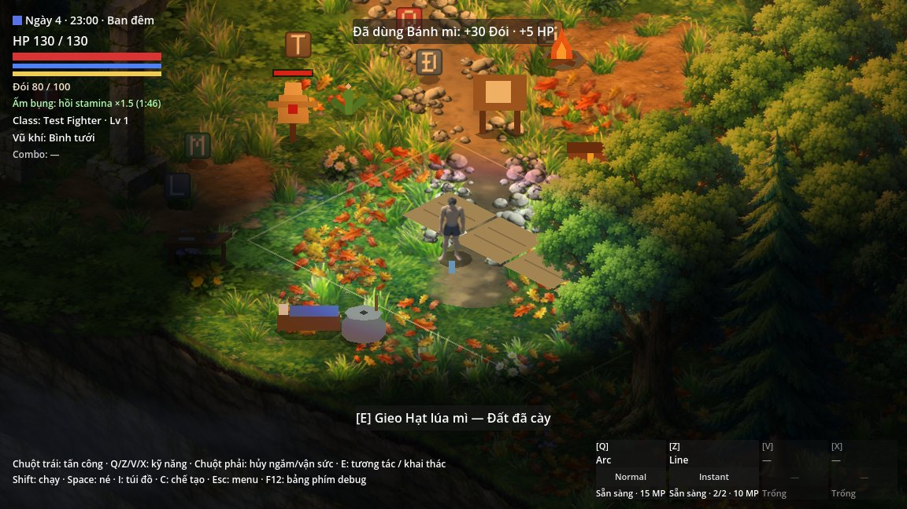 |

## 0. Sửa sau M5

| Mục | Kết quả |
|---|---|
| Cân bằng | `flour.tres` từ 2 lúa → 1 bột thành **3 lúa → 1 bột**. Bảng cân bằng ở dưới và trong architecture 2p đã cập nhật |
| Ruộng đúng lưới | Ô ruộng = đúng 1 ô lưới iso (64 × 32 px), vùng 6 × 4 ô thật, góc trên tại lưới (26, 33). Nhà tạm dời xuống phía nam. Danh sách prop đã dời ở dưới |
| Save v5 ruộng nửa ô | Migration v5 → v6: mỗi ô cũ sang ô mới chứa tâm của nó. Ô bị gộp hoặc ra ngoài lưới thì trả hạt / cây về túi; túi đầy thì rơi cạnh người chơi. Vật dựng nằm trong vùng ruộng mới thì trả item. Có test |
| Phím debug | Chỉ hoạt động khi `OS.is_debug_build()`. Gom vào bảng **F12**, liệt kê đủ các phím. Bản release không phản hồi phím nào, HUD không có gợi ý debug, màn tiêu đề không có nút [Debug] |
| Chơi thử bằng game thật | Bot chạy trọn vòng lặp; kết quả và các chỗ khó chịu ở mục dưới |

### Danh sách prop đã dời

| Node | Loại | Lưới cũ → mới | Lý do |
|---|---|---|---|
| Bed | nhà tạm (giường) | (30.4, 36.2) → (28.4, 38.2) | nằm trong vùng ruộng mới |
| Workbench | nhà tạm (bàn chế tạo) | (32, 36) → (26, 38) | nằm trong vùng ruộng mới |
| TreeOakA10 | cây trang trí, không tài nguyên | (33, 34) → (35, 34.8) | gốc sát mép phải ruộng |
| TreeOakB9 | cây trang trí, không tài nguyên | (31, 37.5) → (37, 34) | tán cây che gần nửa ruộng (thấy khi chơi thử) |
| RuinWall2 | prop trang trí (tường đổ) | (25.5, 36.5) → (22, 38.6) | chắn chỗ đặt bàn chế tạo mới |
| StonePickup, BerryPickup, BreadPickup, TentPickup | vật phẩm đặt sẵn M1–M2 | (27.4, 34.8) → (25.6, 36.6) · (29.6, 34) → (30.2, 32.2) · (30.6, 33.4) → (31.4, 32.4) · (27.8, 35.8) → (24.6, 37) | nằm trong ô ruộng: đi cày là tự nhặt mất (thấy khi chơi thử) |

Rương nằm ngoài vùng nên không dời. Không dời cây hay đá còn tài nguyên. Script dựng Glade (`tools/glade/build_glade_prototype.gd`) đã sửa cùng vị trí.

### Chơi thử vòng lặp trồng trọt (game thật, có cửa sổ)

Bot làm đúng như người chơi. Nó bấm Chơi mới ở ô 1 trên màn tiêu đề, đi bằng phím di chuyển thật theo đường navmesh, rồi dùng E, C + click, I + rê chuột + F, ngủ ở giường bằng E, và Esc + click cho menu. Để rút ngắn, bot được cho sẵn nguyên liệu chế cuốc / bình tưới / cối đá, 1 lửa trại, 4 hạt lúa mì và 4 thịt nướng; giờ được tua bằng F8. Cài đặt và save dùng file riêng (`user://playtest_*`), tắt tự tạm dừng khi mất focus.

| Bước | Kết quả | Ảnh |
|---|---|---|
| Chế cuốc đất, bình tưới, cối đá ở bàn chế tạo | xong | [05](M6/05_crafting.jpg) |
| Trang bị cuốc (I → F), cày 4 ô | 4 / 4 | [06](M6/06_inventory_hoe.jpg) [07](M6/07_tilled.jpg) |
| Gieo lúa mì | 4 / 4 | [08](M6/08_planted.jpg) |
| Múc nước ở mép suối, tưới, ngủ: 3 đêm | tưới 4 / 4 mỗi đêm, tuổi cây [3, 3, 3, 3] | [09](M6/09_fill_water.jpg) [10](M6/10_watered.jpg) [11](M6/11_morning_1.jpg) [12](M6/12_morning_2.jpg) [13](M6/13_morning_3.jpg) |
| Thu hoạch | 10 lúa mì + 7 hạt (4 ô) | [14](M6/14_harvested.jpg) |
| Cối đá cạnh giường, xay 3 lần | 3 bột (9 lúa) | [15](M6/15_mill.jpg) |
| Lửa trại, nướng bánh mì, ăn | đói 50 → 80 | [16](M6/16_bread.jpg) [17](M6/17_ate.jpg) |
| Esc → Lưu ô 1 → Tải / Hướng dẫn phím / Cài đặt | xong | [18](M6/18_pause_menu.jpg)–[25](M6/25_settings_controls.jpg) |

**Các chỗ khó chịu thấy khi chơi thử:**

| # | Thấy gì | Xử lý |
|---|---|---|
| 1 | Menu chọn hạt bật ở góc dưới phải, xa con trỏ: code cộng vị trí cửa sổ OS vào popup nhúng | **Đã sửa** (`World.open_seed_menu` chỉ cộng khi popup là cửa sổ riêng) |
| 2 | Tán cây sồi trang trí TreeOakB9 che gần nửa ruộng, không thấy cây đang lớn | **Đã sửa** (dời cây) |
| 3 | 4 vật phẩm đặt sẵn nằm trên ô ruộng: đi cày là nhặt mất bánh mì / quả mọng (bánh "tự có" khiến bot tưởng đã nướng được) | **Đã sửa** (dời ra ngoài vùng) |
| 4 | Ở mép suối, lần E đầu cắt bụi cỏ sát bên chứ không múc nước (E chọn vật gần nhất), phải nhấn lần nữa | Chưa sửa. Đề xuất: khi cầm bình tưới thì ưu tiên điểm múc nước |
| 5 | Điểm múc nước cách ruộng ~6 ô, đường đi vòng qua bụi mọng và cây. Đi bộ thẳng thì kẹt (bot phải theo navmesh). Ở mép suối nhân vật bị tán cây che gần hết, tán chỉ mờ một phần | Chưa sửa (đổi bố cục suối / cây ngoài phạm vi) |
| 6 | Lửa trại không dựng được sát ruộng: mỗi ô ruộng là vùng tương tác nên PlacementCheck báo "Không đủ chỗ trống để dựng." — thông báo không nói rõ vì sao | Chưa sửa. Đề xuất: thông báo riêng "Không dựng trên ruộng" |
| 7 | Tua giờ F8 vẫn trừ đói. Lần chạy đầu bot không ăn nên chết đói ở ngày 3 (rơi túi cạnh giường), dù vòng lúa mì chỉ 3 ngày | Đúng luật. Ghi nhận: vụ lúa đầu tiên cần mang sẵn đồ ăn cho ~3 ngày |
| 8 | Túi có quả mọng (cũng là hạt) thì lần gieo đầu luôn hỏi chọn hạt | Đúng luật M5 (nhớ lựa chọn cho các ô sau) |
| 9 | Ảnh nhỏ của bản tự lưu chụp lúc vừa ngủ dậy nên tối và có chữ "đã ngủ dậy" | Chưa sửa (nhỏ) |
| 10 | Ô "Không hiện lại" và công tắc tắt (Toàn màn hình, Hiện FPS) gần như không thấy viền với theme tạm | Chưa sửa (style menu là tạm) |
| 11 | Chạy game rồi chuyển sang cửa sổ khác thì game tự dừng (đúng thiết kế); lần chạy bot đầu dừng giữa chừng vì vậy | Đúng thiết kế, tắt được trong Cài đặt → Gameplay |

## 1–6. Đã làm

- **Màn hình tiêu đề** (`app/main.gd`): game mở vào đây chứ không vào thẳng Glade. Nền là ảnh cảnh Glade trôi chậm (`app/art/title_background.jpg`, sinh bằng `tools/title/render_title_background.gd`), tên game là chữ placeholder. Có các nút Tiếp tục (bản mới nhất trong mọi ô; ẩn khi chưa có save) / Chơi mới / Tải game / Cài đặt / Thoát. Điều khiển bằng chuột hoặc mũi tên + Enter; Esc để quay lại. Tay cầm mới chừa chỗ (action `ui_*`, focus sẵn nút đầu, định dạng lưu phím có tiền tố loại).
- **3 ô save + tự lưu** (`save/save_service.gd`, schema 6): mỗi ô là một thư mục `user://saves/slot_<n>/`, gồm `manual.json` / `autosave.json` (kèm `.bak`), ảnh nhỏ `.png` và `meta.json` riêng (ngày / giờ game, playtime, giờ lưu, map). Danh sách ô chỉ đọc meta. Tải game: chọn ô, rồi chọn bản thủ công hoặc tự lưu. Xóa ô và ghi đè đều có xác nhận. Tự lưu khi ngủ ghi vào ô đang chơi.
- **Không cho lưu** khi có quái đang đuổi ("Không thể lưu khi đang bị truy đuổi"), khi đang đi giữa các tầng, đang chuyển cảnh, đang ngủ hoặc đã chết. Lưu nhanh F5 (bản debug) cũng theo luật này.
- **Migration**: save đơn cũ `slot_<n>.json` (v1–v5) tự chuyển thành bản thủ công của ô n mà không đổi nội dung. Migration v5 → v6 thật cho ruộng. Chuỗi v1 → v6 đều chạy.
- **Menu tạm dừng** (`ui/menus/pause_menu.gd`): Esc = `SceneTree.paused`, nên đồng hồ, quái, cây, buff, đói, lửa trại, đuốc và playtime đều đứng yên, chỉ UI menu chạy. Mở túi đồ vẫn không dừng game. Esc đóng túi đồ / chế tạo / hộp thoại / hộp xác nhận trước. Nút: Tiếp tục / Lưu / Tải / Cài đặt / Hướng dẫn phím / Về màn hình chính / Thoát game. Hai nút cuối cảnh báo khi có tiến trình chưa lưu; nút đóng cửa sổ cũng vậy. Mất focus thì tự mở menu, có tùy chọn tắt.
- **Cài đặt** (`user://settings.cfg`, áp dụng ngay): âm lượng Master / Nhạc / Hiệu ứng (`default_bus_layout.tres` tạo 3 bus), toàn màn hình, vsync, giới hạn FPS 30 / 60 / 120 / không giới hạn, hiện FPS, độ sáng ban đêm (ánh trăng 10–30 %, mặc định 16 %; chỉ đổi độ sáng hiển thị, không đổi luật tầm nhìn), tự tạm dừng khi mất focus.
- **Đổi phím**: mọi action người chơi lấy từ InputMap, mỗi action 2 ô phím (phím hoặc nút chuột). Phím trùng thì cảnh báo và hỏi hoán đổi. Có "Khôi phục mặc định". Esc không đổi được.
- **Hướng dẫn phím + HUD**: màn hướng dẫn đọc InputMap, chia nhóm Di chuyển / Chiến đấu / Kỹ năng / Đồ đạc / Tương tác. Mọi tên phím trên HUD đều đọc InputMap: prompt "[E] …", dòng gợi ý, thanh kỹ năng, túi đồ, chế tạo. Lần đầu chơi mới hiện bảng gợi ý, có "Đã hiểu" và "Không hiện lại".
- **Chuyển cảnh** (`core/app/app_overlay.gd`): fade đen khi chuyển tiêu đề ↔ game, tải save, đổi map. Trong lúc chuyển, input người chơi bị chặn và game dừng tới khi áp xong save. Quái chờ navmesh như luật M5.

## Bảng phím mặc định

Esc (`pause_menu`) cố định: mở / đóng menu tạm dừng, đóng cửa sổ đang mở.

| Nhóm | Hành động | Action | Phím |
|---|---|---|---|
| Di chuyển | Đi lên | `move_up` | W / ↑ |
| | Đi xuống | `move_down` | S / ↓ |
| | Sang trái | `move_left` | A / ← |
| | Sang phải | `move_right` | D / → |
| | Chạy (giữ) | `sprint` | Shift |
| | Né | `dodge` | Space |
| | Phóng to / Thu nhỏ | `camera_zoom_in` / `camera_zoom_out` | lăn chuột lên / xuống |
| Chiến đấu | Đánh thường | `basic_attack` | Chuột trái |
| Kỹ năng | Kỹ năng 1–4 | `skill_slot_1..4` | Q / Z / V / X |
| | Hủy ngắm / vận sức | `skill_cancel` | Chuột phải |
| Đồ đạc | Túi đồ | `inventory_toggle` | I / Tab |
| | Chế tạo | `craft_toggle` | C |
| | Dùng / trang bị (trong túi đồ) | `item_use` | F |
| Tương tác | Tương tác / khai thác / thu hoạch | `interact` | E |

Phím debug (chỉ có ở bản debug, liệt kê trong bảng F12):

| Phím | Tác dụng |
|---|---|
| F1 / F2 / F4 | sinh Bóng ma / bầy sói / Thây ma cạnh người chơi |
| F3 | bảng debug combat (Combat Sandbox) |
| F5 / F9 | lưu nhanh vào ô đang chơi / tải nhanh bản mới nhất của ô |
| F6 | cây ở ô dưới con trỏ +1 giai đoạn |
| F7 / F8 | tua giờ ×10 / +1 giờ game |
| F10 | vẽ bán kính phát hiện của quái |
| F11 | tưới hết ruộng |
| F12 | bật / tắt bảng phím debug (và bảng thông tin môi trường) |
| R · 1 / 2 / 3 · P | reset thử nghiệm · vũ khí thử · bảng Class / Progression (Combat Sandbox / test_map) |

## Bảng cân bằng (bột mì 3 lúa → 1 bột)

Nhu cầu ≈ **88 đói / ngày** (như M5).

| Vụ | Sản lượng trung bình | Đói | Nuôi được |
|---|---|---|---|
| 1 ô lúa mì (3 ngày) | 2.5 lúa → 0.83 bột → 0.83 bánh mì | 25 | 0.28 ngày |
| **Một vụ lúa mì cả ruộng (24 ô, 3 ngày)** | 60 lúa → 20 bột → **20 bánh mì** | 600 | **≈ 6.8 ngày** (M5: 10) |
| Tự nuôi liên tục bằng lúa mì | 8.3 đói / ô / ngày | — | ~11 ô (M5: ~7) |
| Một vụ khoai cả ruộng (24 ô, 6 ngày) | 72 khoai | nướng 2016 / sống 864 | ≈ 23 / ≈ 10 ngày (không đổi) |
| 1 ô mọng (sau 6 ngày đầu) | 2.5 quả mỗi 2 ngày | 20 / 2 ngày | ~9 ô (không đổi) |

## Save v6

- Bố cục file: architecture 2q.
- Nội dung save thủ công / tự lưu giống v5, cộng thêm `saved_unix` (thời điểm lưu dạng số, để sắp xếp bản mới nhất).
- `farms.version` 2, thêm `farms.refunds` (đồ trả về túi khi chuyển ruộng; xóa sau khi tải).
- Test tải save đơn v1, v2, v3, v4, v5: chuyển thành ô 1 và tải được.

## 7. Bản export

| Mục | Kết quả |
|---|---|
| Export preset | `export_presets.cfg` — "Windows Desktop", release, x86_64, `build/windows/FantasyRPG.exe`, loại `tests/*`, `docs/*`, `tools/*` |
| `--export-release` | **Không export được .exe: máy chưa có export template Godot 4.7.2.** Godot báo: `No export template found at the expected path: C:/Users/DELL/AppData/Roaming/Godot/export_templates/4.7.2.stable/windows_release_x86_64.exe` (và `windows_debug_x86_64.exe`). Thư mục `export_templates` đang rỗng. Không tự cài template vì agent_rules cấm cài phần mềm trên máy |
| `--export-pack` (không cần template) | Đóng gói được `build/windows/FantasyRPG.pck` (15 MB). Chạy bằng binary Godot 4.7.2 ngoài thư mục project (`--main-pack`): vào màn hình tiêu đề, không có lỗi trong log |
| Chơi mới → lưu → thoát → mở lại → Tiếp tục trên bản export | **Chưa kiểm được trên .exe release** (chưa có template). Cùng luồng này đã kiểm trong test (`continue_restores_saved_state`, `bindings_persist_restart`) |
| Không có phím debug trên bản release | **Chưa kiểm được trên .exe.** Đã kiểm bằng cờ giả lập release `DebugKeys.simulate_release` (8 ca `release_*`). Binary editor là bản debug nên chạy `.pck` bằng nó vẫn có phím debug |

**Các bước bạn cần làm** (cũng có trong README → Export):

1. Mở Godot 4.7.2 → **Editor → Manage Export Templates… → Download and Install**. Cách khác: tải `Godot_v4.7.2-stable_export_templates.tpz` từ trang tải chính thức của Godot rồi chọn **Install from File**.
2. `Godot_v4.7.2-stable_win64_console.exe --headless --path . --export-release "Windows Desktop" build/windows/FantasyRPG.exe`
3. Chạy `build/windows/FantasyRPG.exe` và kiểm tra:
   - vào màn hình tiêu đề, không có nút [Debug]
   - Chơi mới → Esc → Lưu → Thoát → mở lại → Tiếp tục
   - F1–F12 không có tác dụng

## Chỗ tự quyết

- **AppOverlay và GameSettings không phải Autoload** (agent_rules): AppOverlay là node con của `/root` tạo lười; GameSettings là instance RefCounted dùng chung.
- **Tạm dừng = `SceneTree.paused`** chứ không tắt từng hệ một. Menu, AppOverlay và hộp xác nhận chạy `PROCESS_MODE_ALWAYS`.
- **Tiếp tục** tải bản mới nhất (thủ công hoặc tự lưu) trong mọi ô.
- **Đóng cửa sổ không còn tự lưu như M1**: cảnh báo tiến trình chưa lưu giống nút Thoát game, để khỏi ghi đè bản thủ công ngoài ý người chơi.
- **Tiến trình chưa lưu** = có hơn 1 giây chơi kể từ lần lưu / tải gần nhất.
- **Ruộng nửa ô → lưới mới**: giữ ô tiến xa nhất, trả cây chưa chín thành 1 hạt / củ, cây chín thành sản lượng tối thiểu.
- **Đổi map**: Glade chưa có lối sang map khác trong game. Chuyển map dùng chung `AppOverlay.change_scene`, đã kiểm qua tải save và tiêu đề ↔ game.
- **Dời vật phẩm đặt sẵn** ra khỏi ruộng (spec không nhắc tới) — lý do: chơi thử thấy đi cày là nhặt mất.

## Giới hạn

- Chưa có âm thanh / nhạc thật (chỉ có bus), art thật, đa ngôn ngữ, cloud save, tay cầm (theo task).
- Chưa có .exe release do thiếu template.
- Style menu là tạm.
- Chưa đặt tên cho ô save.
- Chỗ khó chịu #4, #5, #6, #9, #10 ở trên chưa sửa.

## Kết quả test

`tests/run_all.gd`: **13/13 test pass** — **app 120 (mới)**, crafting 40, environment_prototype 17, iso_combat 30, farming 85, gathering 92, inventory 52, navigation 16, night 104, player_sprite 57, save_load 60, smoke 4, survival 94.

Test cũ chỉ đổi cho khớp cấu trúc mới:
- dọn thư mục save theo bố cục ô mới (`clear_dir`, `get_slot_path`);
- bỏ ca `autosave_on_quit` (đóng game không còn tự lưu), nên save_load còn 60 ca (M5: 61);
- kỳ vọng schema 5 → `SCHEMA_VERSION` (6), `farms.version` 2;
- tọa độ đứng trong test ruộng theo vị trí nhà tạm mới;
- công thức bột 3 lúa.

## Đối chiếu spec M6

| Mục spec | Trạng thái | Bằng chứng |
|---|---|---|
| 0. Bột 3 lúa → 1, cập nhật bảng cân bằng | Xong | `flour.tres`; bảng trên; architecture 2p |
| 0. Ô ruộng = 1 ô lưới, 6×4 ô thật; ghi lại prop đã dời | Xong | `farm_field.gd`; bảng prop ở trên |
| 0. Save v5 ruộng nửa ô → lưới mới, không mất đồ, có test | Xong | `half_grid_remapped`, `half_grid_refunds`, `deployed_in_field_removed`, `half_grid_refunds_in_bag`, `half_grid_full_bag_drops`, `refunds_not_saved_again` |
| 0. Phím debug chỉ ở bản debug, bảng F12, release không có | Xong | `debug_f12_panel`, `debug_f12_hides`, `release_*` (8 ca) |
| 0. Chơi thử bằng game thật, ảnh từng bước, ghi chỗ khó chịu | Xong | `tools/playtest/farming_playtest.gd`, `docs/reports/M6/`, bảng trên |
| 1. Mở vào tiêu đề; nền Glade; 5 nút; Tiếp tục ẩn khi chưa có save; chuột + mũi tên + Enter | Xong | `title_is_main_scene`, `title_continue_hidden_without_save`, `title_buttons`, `title_has_background`, `title_arrow_moves_focus`, `title_enter_opens_load_list` |
| 2. 3 ô thủ công + tự lưu, metadata, ảnh nhỏ, meta file riêng | Xong | `three_slots_listed`, `meta_slot_2`, `meta_file_separate`, `list_reads_meta_only`, `thumbnail_saved`, `autosave_into_current_slot` |
| 2. Tải chọn bản; xóa có xác nhận; chơi mới ghi đè có xác nhận | Xong | `load_slot_2_manual`, `load_slot_3_autosave`, `delete_confirm`, `overwrite_slot_2` |
| 2. Không lưu khi bị đuổi / giữa các tầng | Xong | `save_blocked_when_chased`, `quick_save_blocked_when_chased`; `get_save_block_reason` |
| 2. Save đơn v1–v5 → ô 1; migration v5 → v6 | Xong | `legacy_v1..v5_moved_to_slot_1`, `legacy_v1..v5_loaded` |
| 3. Esc dừng thật (đồng hồ, quái, cây, buff, đói, lửa trại, đuốc), tiếp tục chạy lại | Xong | `pause_freezes_clock_enemy_hunger_fire_torch_buff`, `resume_clock_runs_normally`, `resume_world_runs`, `pause_crop_not_growing`, `resume_crop_grows_one_day` |
| 3. Túi đồ không dừng game; Esc đóng túi / chế tạo / hộp thoại trước | Xong | `inventory_open_not_paused`, `esc_closes_inventory_first`, `esc_closes_crafting_first`, `esc_closes_confirm_first` |
| 3. Nút menu; cảnh báo chưa lưu; mất focus tự dừng + tùy chọn tắt | Xong | `unsaved_warning_on_title`, `window_close_warns_unsaved`, `focus_out_pauses`, `focus_out_option_off` |
| 4. Cài đặt lưu ở settings.cfg, áp dụng ngay, đủ mục; audio bus | Xong | `audio_buses_exist`, `settings_applied_now`, `moonlight_changes_ambient`, `settings_reloaded`, `settings_sanitized` |
| 4. Đổi phím: trùng → hỏi hoán đổi, khôi phục mặc định, không đổi Esc | Xong | `conflict_asks_swap`, `swap_applied`, `conflict_declined_keeps`, `reset_defaults`, `esc_not_bindable`, `api_rejects_esc` |
| 4. Phím mới dùng ngay, lưu qua lần mở sau | Xong | `new_key_works_immediately`, `old_key_no_longer_interacts`, `bindings_persist_restart` |
| 5. Hướng dẫn phím đọc InputMap, chia nhóm; HUD không ghi cứng | Xong | `key_guide_follows_binding`, `hud_prompt_new_key`, `hud_hint_new_keys`, `skill_bar_new_key`, `inventory_hint_new_key`, `hud_after_reset` |
| 5. Bảng gợi ý lần đầu chơi mới + "Không hiện lại" | Xong | `start_hints_shown_and_paused`, `start_hints_closed_dont_show_again` |
| 6. Fade đen; chặn input khi tải | Xong | `transition_blocks_and_pauses`, `transition_fades_back`, `fade_cleared` |
| 6. Về màn hình chính rồi Tiếp tục đúng trạng thái | Xong | `back_on_title`, `continue_visible`, `continue_restores_saved_state` |
| 7. Export preset Windows release | Xong | `export_presets.cfg` |
| 7. Export thử và chạy được | **Chưa xong — thiếu export template** | mục 7 ở trên (lý do + các bước); `.pck` chạy được |
