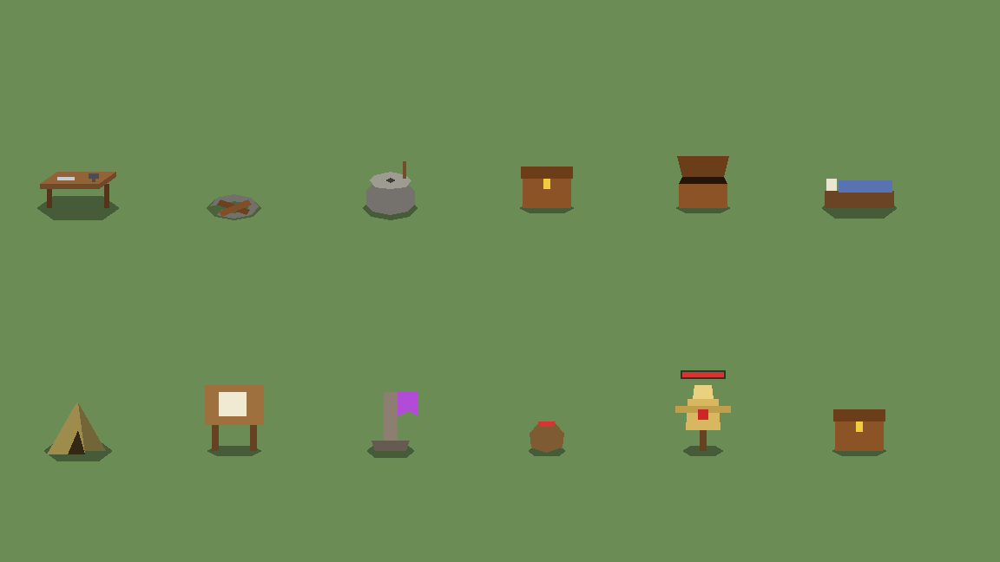
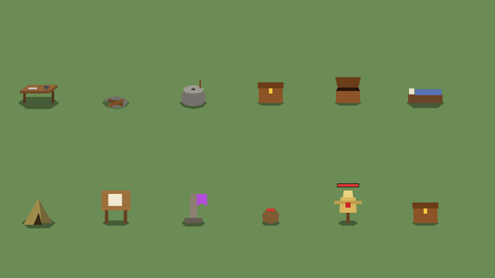
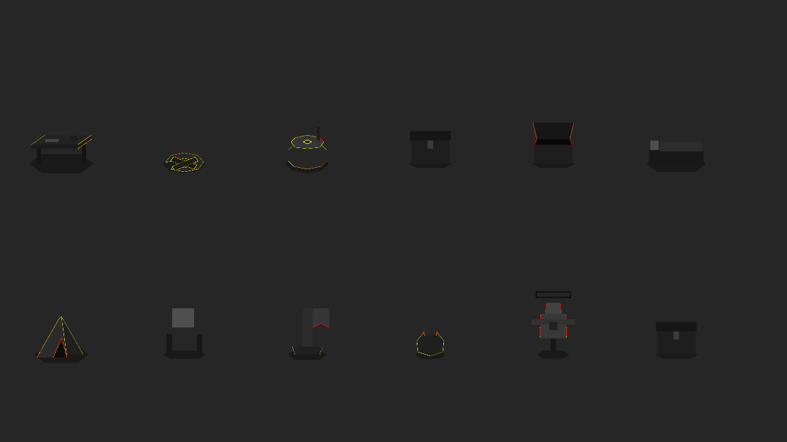
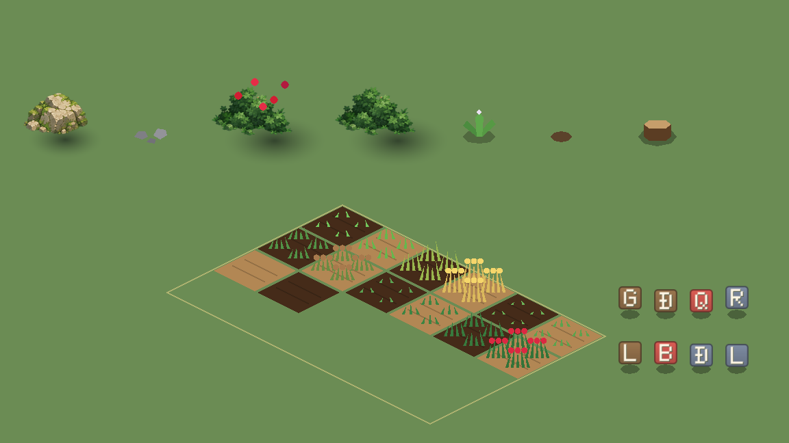
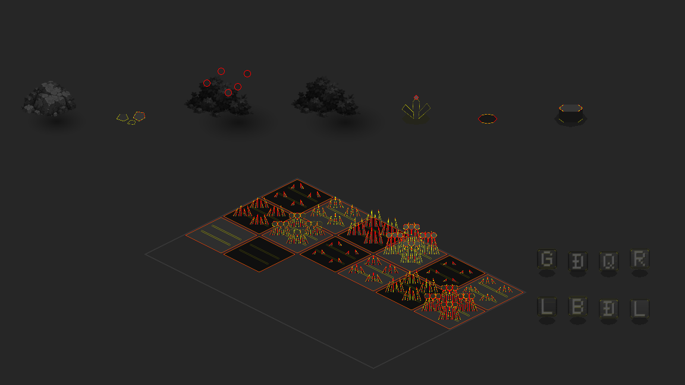
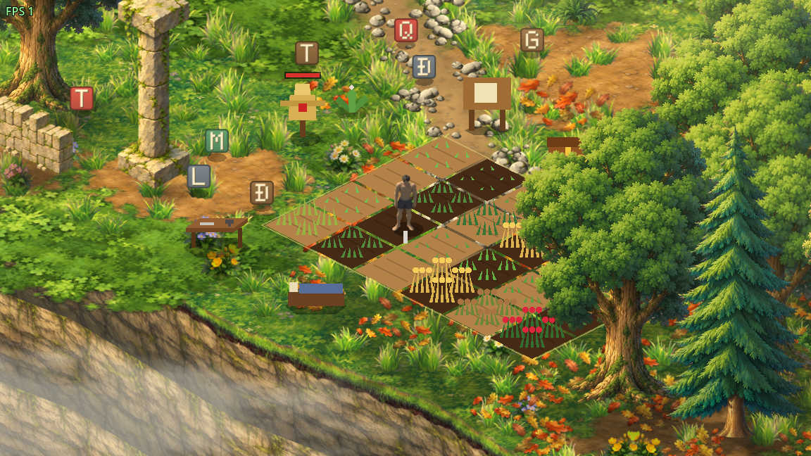
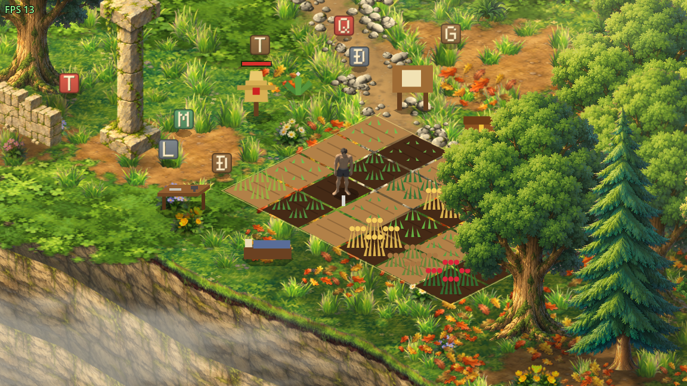
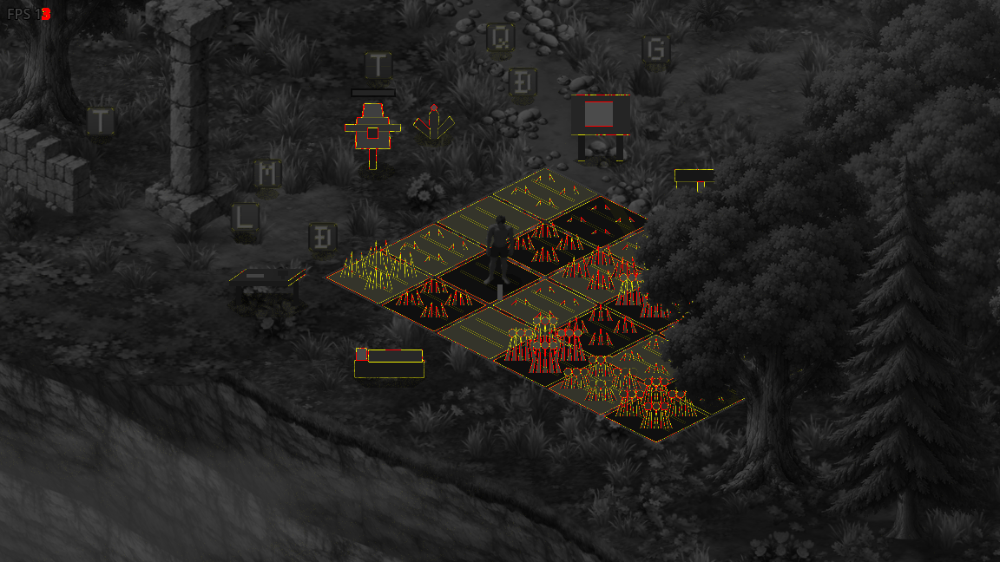
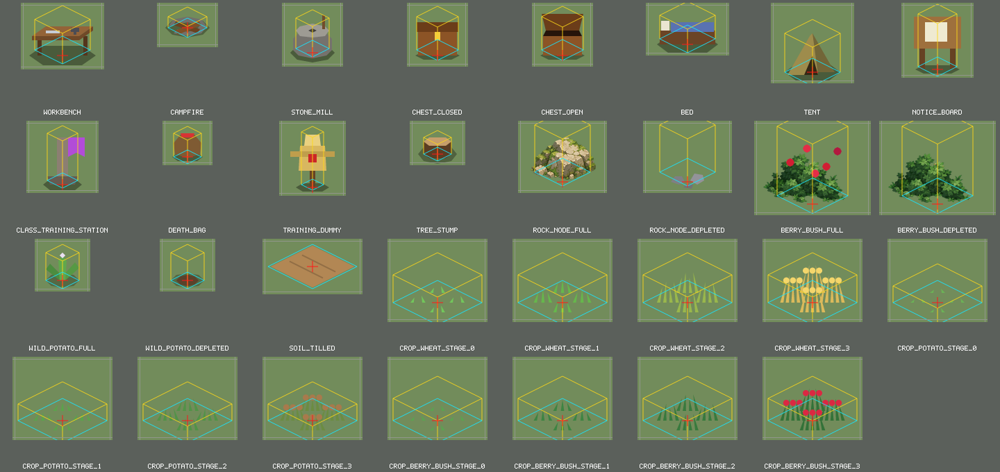
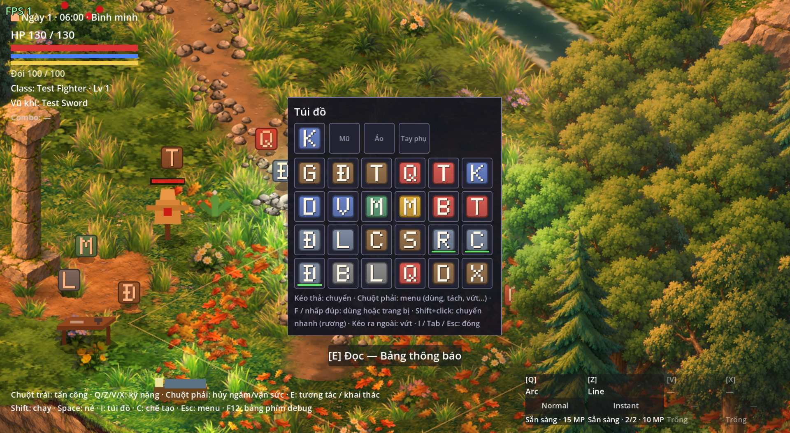

# Báo cáo TASK M7 — Chuẩn bị art đợt 2: đồ vật gameplay + icon

Một commit (`Task: M7`). Chi tiết kỹ thuật ở [architecture.md](../architecture.md) mục 2r, kích thước ở [style guide](../visual/environment-style-guide.md) mục 13, danh sách gen ở [art_requests_batch2.md](../visual/art_requests_batch2.md). Ảnh nằm trong [M7/](M7/), chụp từ game thật có cửa sổ (1152 × 648, zoom 2×) bằng `tools/object_art/capture_gallery.gd`.

Không vẽ art thật. Mọi đồ vật gameplay giờ là ảnh PNG, nhưng ảnh vẫn là hình polygon cũ vẽ lại, nên game nhìn như trước. Muốn thay art thì ghi đè PNG cùng tên, cùng kích thước.

## Ảnh trước / sau

Cùng scene, cùng góc camera, cây scene dừng lúc chụp. "Trước" chụp trên code cũ (Polygon2D), "sau" chụp trên code mới (sprite). Ảnh lệch: pixel lệch hơn 0.1 (kênh màu lớn nhất) tô đỏ, lệch nhỏ hơn tô vàng.

| Cảnh | Trước | Sau | Lệch |
|---|---|---|---|
| Trạm, đồ dựng, rương đóng / mở, bù nhìn |  |  |  |
| Node khai thác còn / hết, ruộng (3 cây × 4 giai đoạn, đất khô / ướt), vật phẩm trên đất |  |  |  |
| Glade quanh nhà tạm |  |  |  |

| Cảnh | Pixel lệch > 0.1 | Lệch trung bình | Lệch lớn nhất |
|---|---|---|---|
| gallery_stations | 219 / 746 496 (0.029 %) | 0.0001 | 0.25 |
| gallery_nodes | 4 546 (0.61 %) | 0.0014 | 0.46 |
| glade_home | 4 492 (0.60 %) | 0.0018 | 0.71 |

Mọi chỗ lệch đều nằm **ở mép hình**, không có chỗ nào bị dời. Lý do: Polygon2D cũ vẽ không khử răng cưa, còn PNG được vẽ có khử răng cưa (4 × 4 mẫu mỗi texel) rồi lọc Linear Mipmap. Vì vậy mép mềm hơn một chút. Lá cây trồng rất mảnh (rộng 2.4 px) nên ruộng có nhiều pixel mép nhất. Đá và bụi mọng ở trạng thái "còn" dùng đúng ảnh prop cũ nên không lệch pixel nào (trừ quả mọng). Ảnh Glade còn lệch cả ở vùng không liên quan: nhãn FPS, nước và sương động theo thời gian.

Collision, vùng tương tác, Y-sort, tầng (ElevationAgent) giữ nguyên, không sửa dòng nào. Test cũ về collision và tương tác (gathering, farming, night, nav…) vẫn pass.

## Ảnh lưới mọi khuôn

Mỗi khuôn (`tools/object_art/templates/<file>.png`) gồm ảnh game và các nét hướng dẫn:
- **bóng code** (xám);
- **thoi footprint** (xanh lơ);
- **khung chiều cao** (lăng trụ vàng);
- **chữ thập ở điểm neo** (đỏ);
- **viền lề 4 texel** (xám).

Túi đồ ở cửa sổ 1920 × 1080 (icon 128 × 128): 

## 1. Tỉ lệ & kích thước

Bảng đầy đủ ở style guide mục 13 (kích thước ảnh, anchor, footprint, chiều cao đề xuất, trạng thái). Tóm tắt (px world; nhân vật cao ~39 px; ô lưới 64 × 32):

| Asset | Ảnh (texel) | Anchor | Cao | So với nhân vật |
|---|---|---|---|---|
| workbench | 120 × 96 | (60, 76) | 22 | ngang hông, dài ~1.1 |
| campfire (đế) | 88 × 64 | (44, 36) | 8 | lửa code cao tới 21 |
| stone_mill | 88 × 92 | (44, 72) | 22 (cán 27) | ~0.6 |
| chest closed / open | 88 × 92 | (44, 76) | 24 / 30 | ~0.6 |
| bed | 120 × 76 | (60, 60) | 17 | dài 40 ≈ 1.03 nhân vật (khung cho phép tới ~1.3) |
| tent | 120 × 116 | (60, 100) | 28 (khung tới 48) | 0.7 → 1.2 |
| notice_board | 104 × 108 | (52, 96) | 38 | ≈ 1 |
| class_training_station | 104 × 104 | (52, 92) | 34 | ~0.9 |
| death_bag | 72 × 64 | (36, 52) | 17 | ~0.45 |
| training_dummy | 96 × 108 | (48, 96) | 38 | ≈ 1 |
| tree_stump | 80 × 64 | (40, 48) | 12 | ~0.3 |
| rock_node full / depleted | 128 × 104 | (64, 88) | 34 | |
| berry_bush full / depleted | 168 × 136 | (84, 120) | 50 | |
| wild_potato full / depleted | 80 × 76 | (40, 60) | 20 | |
| soil_tilled | 144 × 80 | (72, 40) | 0 | đúng 1 ô lưới |
| crop_<id>_stage_<n> (3 cây × 4) | 144 × 120 | (72, 92) | `mature_height` | cả ô ruộng |
| icon | 128 × 128 | — | — | ô túi đồ ≈ 63 px màn hình ở 1080p |

Tôi giữ đúng hình placeholder hiện tại (footprint = collision hiện có). Khung ảnh rộng hơn hình một chút để art thật có chỗ, ví dụ giường dài tới ~1.3 nhân vật, lều cao tới ~1.2. **Icon ở 1920 × 1080**: ô túi đồ dành 38 px viewport gốc cho icon, tức khoảng 63 px trên màn hình. Icon 128 px được thu nhỏ khoảng 2 lần, có mipmap, nên nét (ca `icon_sharp_in_slot_1080p` và ảnh túi đồ ở trên). Ảnh kéo-thả trong túi đồ và icon trong cửa sổ chế tạo trước đây không bật mipmap. Icon 128 thu nhỏ 4 lần mà không có mipmap thì bị răng cưa, nên tôi bật lọc Linear Mipmap cho hai chỗ này.

## 2. Khuôn PNG — `tools/object_art/` (có `.gdignore`)

- `generate_object_art.gd`: mỗi asset / trạng thái sinh ra:
  - ảnh game ở thư mục `art/` cạnh scene (icon ở `features/items/icons/`);
  - khuôn hướng dẫn ở `templates/`;
  - `core/object_art/object_art.json` (tên, file, kích thước, anchor, footprint, chiều cao, trạng thái, `texel_scale`, danh sách icon).
- Nếu hình tràn ra ngoài lề 4 texel, tool báo lỗi và dừng.
- Cây trồng đọc từ `CropBook`: số giai đoạn, màu, chiều cao lấy từ `features/farming/data/*.tres`.
- **Luật ghi đè**: tool chỉ ghi ảnh game / icon khi file chưa tồn tại, hoặc khi có `--force <tên>`. Tên là tên file không đuôi, icon thì thêm tiền tố `icon:` (vd. `icon:wood`). Tên không tồn tại thì tool báo lỗi, tránh gõ nhầm. Có test chạy tool thật vào thư mục tạm (`OBJECT_ART_ROOT`).
- Hình placeholder: `object_shapes.gd` được trích **một lần** từ Polygon2D cũ bằng `extract_shapes.gd` (giữ lại để biết nguồn gốc). Đá / bụi mọng ở trạng thái "còn" là ảnh prop môi trường được dán vào.
- `tools/item_icons/` (M1) được thay bằng tool này. Icon giữ kiểu cũ (ô màu theo loại + chữ cái đầu), phóng ×2 lên 128. Lần chạy này tôi dùng `--force` cho đủ 37 icon cũ 64 × 64.

## 3. Scene đã đổi

| Scene | Thay đổi |
|---|---|
| `features/crafting/stations/workbench.tscn`, `stone_mill.tscn` | Visual → `Shadow` (ObjectShadow) + `Sprite` (ObjectSprite) |
| `features/crafting/stations/campfire.tscn` (+ `.gd`) | như trên; ngọn lửa `Flame` (hiệu ứng code) dời ra ngoài Visual |
| `features/inventory/chest/chest.tscn` (+ `.gd`) | Sprite `chest` closed / open |
| `features/interaction/examples/test_chest.tscn` (+ `.gd`, test_map) | dùng chung ảnh rương (polygon giống hệt) |
| `features/survival/rest/bed.tscn`, `tent.tscn`, `features/survival/death/death_bag.tscn` | Shadow + Sprite |
| `features/interaction/examples/notice_board.tscn`, `features/classes/station/class_training_station.tscn` | Shadow + Sprite |
| `entities/enemies/training_dummy/training_dummy.tscn` (+ `.gd`) | Shadow + Sprite; rung khi trúng đòn |
| `features/gathering/nodes/tree_node.tscn` | `Depleted` = Shadow + Sprite `tree_stump` |
| `features/gathering/nodes/rock_node.tscn`, `berry_bush_node.tscn` | ẩn Visual của prop, thêm Sprite full / depleted (`ResourceNode` đổi trạng thái) |
| `features/gathering/nodes/wild_potato_node.tscn` | `Available` = bóng; Sprite full / depleted |
| `features/inventory/pickup/item_pickup.tscn` (+ `.gd`) | bóng → ObjectShadow; icon thu theo `icon_size` 19.2 px world |
| `features/farming/farm_plot.gd`, `farm_field.gd`, `farm_layer.gd` | cây: ObjectSprite `crop_<id>` / `stage_<n>`; đất: ObjectSprite `soil_tilled` + tint ướt |
| `world/environment/iso/iso_actor_adapter.gd`, `features/spawning/enemy_spawner.gd` | `shadow` nhận Polygon2D hoặc ObjectShadow (bù nhìn ở Glade) |

**Bóng đổ: chọn vẽ bằng code** (`ObjectShadow`, giữ đúng hình bóng cũ), không vẽ trong ảnh. Lý do:
- mọi trạng thái của một món dùng chung một bóng;
- art gen AI không phải khớp hình bóng, và prompt đã ghi "no cast shadow";
- prop môi trường cũng để bóng thành lớp riêng;
- `IsoActorAdapter` vẫn đặt lại bóng cho bù nhìn ở Glade.

Import: mọi PNG mới đều bật `mipmaps/generate` và `fix_alpha_border` (style guide mục 10). `ObjectSprite` lọc Linear Mipmap. Test kiểm tra file `.import` của từng ảnh.

## 4. Danh sách gen

[docs/visual/art_requests_batch2.md](../visual/art_requests_batch2.md) gồm:
- prompt chung cho đồ vật (theo style guide mục 11, nền magenta, không bóng) và prompt chung riêng cho icon;
- 16 mục đồ vật, mỗi mục có tên file, kích thước, mô tả tiếng Anh, trạng thái, ghi chú khớp khuôn;
- 33 icon, mỗi icon một dòng (bỏ 4 item `test_*`, file của chúng vẫn có);
- thứ tự ưu tiên (ruộng → nhà tạm → icon hay dùng → khai thác → …);
- bảng trống "nhật ký gen".

## Chỗ tự quyết

- **Khuôn hướng dẫn tách khỏi ảnh game.** Spec muốn khuôn có thoi, chữ thập, khung chiều cao, bóng *và* game nhìn y như cũ. Nếu vẽ nét hướng dẫn vào PNG mà game đọc thì nét sẽ hiện trong game. Nên ảnh game chỉ có hình placeholder, còn khuôn đầy đủ nằm ở `tools/object_art/templates/` (cùng kích thước, cùng anchor, đặt chồng lên được).
- **Bóng trên khuôn là bóng code thật** (đặt giữa chân), không lệch xuống-phải. Bóng trong game phải y như cũ, mà khuôn cần cho thấy đúng chỗ code vẽ bóng để art không tự vẽ thêm bóng. Hướng nắng trên-trái và bóng xuống-phải vẫn ghi trong prompt để tô khối sáng / tối.
- **`object_art.json` nằm ở `core/object_art/`**, không nằm trong `tools/`. `tools/` có `.gdignore` và bị loại khỏi bản export, mà ObjectSprite phải đọc JSON lúc chạy. Đã kiểm tra `--export-pack`: JSON có trong pck.
- **Đá / bụi mọng "còn"** là ảnh riêng (`rock_node_full`, `berry_bush_full`), hiện là bản sao ảnh prop môi trường, để node có đủ hai trạng thái theo spec. Collision và bóng mềm vẫn lấy từ prop, nên footprint không đổi.
- **Ảnh cây trồng phủ cả ô** (4 khóm), không vẽ từng khóm, để dễ gen một ảnh / giai đoạn. Ảnh này giả định ô ruộng = 1 ô lưới iso (đúng với Glade).
- **Bù nhìn rung**: dịch ngang tối đa 2 px, giảm dần, trong 0.25 s. Chỉ ảnh rung, bóng đứng yên. HitFlash vẫn nháy như cũ.
- Gộp `tools/item_icons/` vào tool mới để icon cũng theo luật không ghi đè.

## Chỗ không đổi được / không đổi và lý do

- **Ngọn lửa trại**: vẫn là 2 Polygon2D (hiệu ứng code, đúng spec), đã dời ra khỏi Visual. Test "không còn Polygon2D" chỉ cho phép đúng ngoại lệ này.
- **Viền vùng ruộng** (đường kẻ vàng mờ) vẫn vẽ code: đây là vạch chỉ vùng, không phải asset.
- **Cây sồi khi còn nguyên**: vẫn là `tree_oak_a` (spec yêu cầu giữ).
- **test_crystal** (đồ thử ở test_map) và enemy / quái vẫn là polygon (ngoài phạm vi đợt 2).
- **Mép hình mềm hơn một chút** so với polygon cũ, do khử răng cưa (xem bảng lệch). Tôi giữ khử răng cưa vì khuôn sạch hơn, và lệch chỉ nằm ở mép.

## Giới hạn

- Mọi ảnh vẫn là placeholder (chưa có art thật, đúng spec).
- Ảnh cây trồng chỉ khớp ô ruộng 1 ô lưới iso.
- PNG mới sinh ra phải tự bật mipmaps trong `.import` (Godot mặc định tắt). Test bắt lỗi nếu quên.
- Quái, nhân vật, HUD / UI skin chưa làm (đợt sau).

## Kết quả test

`tests/run_all.gd` (lần chạy cuối): **14/15 test pass**:
- **art 40 (mới)**, app 128, crafting 40, environment_prototype 17, iso_combat 30, farming 85, gathering 92, inventory 52, navigation 16, player_sprite 57, polish 25, save_load 60, smoke 4, survival 94;
- **night 103/104**: `shade_never_enters_light` fail (Bóng ma tới gần nhất 298.4 px so với bán kính lửa trại 300).

**Ca fail của night có sẵn từ trước M7, không do M7 gây ra.** Tôi chạy `tests/night/test_night.gd` 6 lần trên worktree của commit gốc `4fd01ee` (chưa có M7): 4 lần fail với đúng con số 298.4, 2 lần pass (316.9). Trên code M7 kết quả cũng lúc pass lúc fail (1/3 lần chạy riêng fail). Đây là test phụ thuộc ngẫu nhiên của AI Bóng ma, nằm ngoài phạm vi M7 nên tôi không sửa. Vì luật "toàn bộ pass mới push", **commit M7 chưa được push**.

`test_nav_bake` có lúc fail vì spike frame (44.6 / 80 ms) khi máy đang chạy tiến trình Godot khác song song. Chạy riêng 5 lần đều pass (max frame 18–21 ms), và lần chạy suite cuối cũng pass.

Test cũ: không sửa ca nào.

## Đối chiếu spec M7

| Mục spec | Trạng thái | Bằng chứng |
|---|---|---|
| Trạm & đồ dựng (9 món, rương đóng / mở, lửa giữ code) sang sprite | Xong | bảng scene; `scenes_use_object_sprite`, `campfire_flame_still_code`, `chest_open_image_on_e` |
| Node khai thác: gốc cây, đá còn / hết, bụi mọng có / hết quả, khoai dại còn / đã đào | Xong | `node_image_glade_*` (4 ca, input thật) |
| Đất cày 1 ô lưới, ướt bằng tint; cây trồng đủ giai đoạn đọc từ data | Xong | `soil_*`, `crop_*`, `every_stage_shows_its_image`, `crop_every_stage_has_image` |
| Bù nhìn 1 ảnh tĩnh, rung khi trúng đòn bằng code | Xong | `dummy_hit_by_real_attack`, `dummy_shakes_on_hit`, `dummy_shake_settles` |
| Icon mọi item 128 × 128 | Xong | `icons_all_items_128`, `icons_listed_in_json` |
| 1. Bảng kích thước (style guide mục 13), icon nét ở ô túi đồ 1920 × 1080 | Xong | style guide 13; `icon_sharp_in_slot_1080p`; ảnh túi đồ |
| 2. Tool khuôn: thoi, chữ thập, khung cao, bóng, polygon cũ, lề ≥ 4; JSON; art/ cạnh scene; không ghi đè + `--force` tên; có test | Xong | `tools/object_art/`; `catalog_png_size_margin_import`; `tool_*` (4 ca), `should_write_rule` |
| 3. Component chung đọc anchor từ JSON, đổi trạng thái bằng tên | Xong | `ObjectSprite`; `sprite_offset_scale_from_json`, `unknown_state_reports_error` |
| 3. Thống nhất bóng đổ, ghi lý do | Xong | bóng code, lý do ở trên + style guide 13 |
| 3. Collision / tương tác / Y-sort / tầng giữ nguyên; ảnh trước / sau cùng góc | Xong | không sửa node collision; ảnh + bảng lệch ở trên |
| 3. Import mục 10 | Xong | `.import` của 31 ảnh + 37 icon; test kiểm |
| 3. Vật phẩm trên đất: icon thu nhỏ + bóng, nảy | Xong | `pickup_icon_scaled_to_world_size` |
| 4. art_requests_batch2.md (prompt, ưu tiên, nhật ký) | Xong | `docs/visual/art_requests_batch2.md` |
| 5. Test bắt buộc (PNG đủ trạng thái + kích thước, icon, giai đoạn, đổi trạng thái + lưu / tải, không Polygon2D, tool không ghi đè) | Xong | `tests/art/test_object_art.gd` |
